# Recommendations: update the curriculum business page to the state of 06 Nov 2026

Date: 06 Nov 2026. Written for the owner.

Target page: `/Users/rabies/global_experience/automated-curriculum-development-business.html`

This file gives one recommendation for each change that the owner asked for on 06 Nov 2026. Each recommendation names the panel, the current text, the source that proves the new text, and draft text. The draft text is a proposal. Nothing on the page is changed yet.

## Decisions and status, 06 Nov 2026

The owner answered the nine questions of section 10 on 06 Nov 2026:

| Question | Answer | Effect on the page |
|---|---|---|
| 1 | (a) | The overview diagram shows the nine KAN-1 stages, with CourseFactory v2 in the English text stage. |
| 2 | (a) | Panel 6 gets only the corrections of section 7. |
| 3 | (b) | The cosmetology row says "approved by TDLR in Nov 2026". |
| 4 | (a) | Panel 2 names the knowledge graph. A separate task adds a graph refresh to `/ierhub-current-state`. That task is not done. |
| 5 | (a) | Panel 7 does not name the overnight runner. |
| 6 | (a) | A new nine stage diagram replaces the panel 3 diagram. |
| 7 | (a) | The compliance table keeps the 15 day certificate deadline. |
| 8 | Title Case for every subtitle on every panel | Every navigation subtitle, panel subtitle and stage heading uses Title Case. The global rule does not change. |
| 9 | (a) | Panel 7 names the herdr director only. |

The owner also asked for a place for the diagram of how plans run. It is in panel 7, section "How a Plan Runs from Start to Finish". Source: `/Users/rabies/global_experience/diagrams/plan-run.mmd`.

Status of the work:

| Step | State |
|---|---|
| Text changes, all 7 panels | Done by `/Users/rabies/global_experience/plans/apply-page-update-06Nov2026.py`. The STE-Checker gives no finding on the page text. Each panel has balanced `div` tags. |
| Diagram sources | Done: `business-overview.mmd`, `session-pipeline.mmd`, `dwell-gate.mmd` and `plan-run.mmd` in `/Users/rabies/global_experience/diagrams/` |
| Diagram render and insert | Open. The sandbox stops Chrome, so the session cannot render. The page shows 4 empty placeholders until the owner runs the render command. |
| Check in Claude in Chrome | Open. The sandbox stops a local web server, and the browser tool refuses `file://` addresses. |
| Graph refresh in `/ierhub-current-state` | Open, a separate task (answer to question 4) |
| Commit | Not done. No commit without an owner request. |

### Update, 08 Nov 2026

The owner asked for the plan text to show what `--done` does when a plan is finished. Two changes are done:

- **Diagram.** `/Users/rabies/global_experience/diagrams/plan-run.mmd` now has a group "What --done does" with six boxes, in the order of the script. The script first proves that the branch is on `origin/main`. Then it stops the idle watcher and the dev server, removes the worktree, runs `git worktree prune`, deletes the local branch and moves the plan folder to `PastPlans`.
- **Panel 7 text.** A new paragraph under "How a Plan Runs from Start to Finish" in `/Users/rabies/global_experience/automated-curriculum-development-business.html` says the same thing in prose.

One box changed its meaning. The first diagram said "Delete the local branch with -d". The script `/Users/rabies/Desktop/Tools/new-feature/scripts/new-feature.sh`, line 394, runs `git branch -D`. A comment in the script gives the reason: the merge check before it is the guard. The box now says "Delete the local branch", with no flag. This fact is **verified**.

The preview page of all 16 panel diagrams is `/private/tmp/claude-501/-Users-rabies-global-experience/c5f6d6fc-5241-4603-b87a-9aa251fdf427/scratchpad/panel-diagram-previews-08Nov2026.html`. It copies the 12 diagrams that are on the page now. It renders the 4 new diagrams from their source files in the browser, with Mermaid 11.4.1 from cdn.jsdelivr.net. No session opened the preview page, so no session saw the 4 new diagrams render. A syntax error in a source file shows as an error box on the preview page.

Work that is not complete:

| Order | Work | Who | Why it is open |
|---|---|---|---|
| 1 | Open the preview of the full page and look at the 6 changed diagrams: `business-overview`, `operating-loop`, `op-records`, `session-pipeline`, `dwell-gate` and `plan-run`. | Owner | The sandbox stops the browser tool from opening a local file. |
| 2 | Run the render command. It writes 6 SVG files to `/Users/rabies/global_experience/diagrams/rendered/` and puts them into the page. | Owner | The sandbox stops Chrome, which the render tool needs. The 2 SVG files for `dwell-gate` and `session-pipeline` in that folder are from 29 Jul 2026, and the render replaces them. |
| 3 | Check every panel of the page in Claude in Chrome. | Session, after step 2 | This needs `sandbox.network.allowLocalBinding: true`, or a web server that the owner starts. |
| 4 | Add a graph refresh to `/ierhub-current-state`. | Separate task | Answer to question 4. Not started. |
| 5 | Commit the page, the diagram sources and the plan files. | Session, on owner request | No commit without an owner request. |

### Changes on 08 Nov 2026, second and third requests

The owner chose option (a) on 08 Nov 2026: this section holds the record of the changes. The full reasons for the merges are in `/Users/rabies/global_experience/plans/RECOMMENDATIONS-diagram-merge-08Nov2026.md`.

- `business-overview.mmd` shows a general course subject. It names no current course. The group titles and the line labels are shorter, so that no label is cut off.
- `session-pipeline.mmd` gives every box a full action, in the words of the panel 3 table. "Rules and sources" is now "Get the rules and map them to modules".
- `operating-loop.mmd` is one sequence from the goal to `MIGRATION-MAP.md`. It now holds the session waterfall as a group, so `op-waterfall` is no longer on the page. The waterfall text in panel 2 is now above the merged diagram.
- The new `op-records.mmd` holds the three wiki tiers and the daily mirror job in two groups. It replaces `op-wiki-tiers` and `op-continuity` on the page. The continuity text in panel 2 is now under the wiki text, above the merged diagram.
- The email diagram `op-emails` and its text moved from panel 2 to panel 6, after the delivery diagram.
- The CSS rule for the small blue labels above each heading now applies to every panel. Before, it applied only to panel 2, so the labels in panel 7 had no style.
- The page uses American spelling: "enrol" in the delivery diagram is now "enroll". A search for 46 British spelling patterns found no other case on the page or in the diagram sources.
- CSS line 26 of the page now reads `--dur: 0.3s;`. The web address is removed.
- A new CSS rule lets a diagram label show in full when the browser font is wider than the font that the render tool used.
- The render command now renders 6 diagrams.
- 08 Nov 2026, last request: panel 4 "CourseFactory v2" is now part of panel 3 "How a Course Gets Built". Compliance, Delivery and How AI Is Used are now panels 4, 5 and 6.
- 08 Nov 2026, last request: a fallback block at the end of the page draws each unrendered diagram in the browser, so the page shows no empty diagram. The render command removes the block when it bakes the last SVG.
- The handoff for the next session is `/Users/rabies/global_experience/plans/HANDOFF-page-update-08Nov2026.md`.

Each fact carries one of three marks:

- **Verified**: a session read the fact in the named file on 06 Nov 2026.
- **Inferred**: a session concluded the fact from the named file. The file does not state it.
- **Unknown**: no file that a session read states the fact.

## Sources

| Source | Path |
|---|---|
| New course checklist, the source of Jira KAN-1 | `/Users/rabies/Desktop/IERHUB.com/5-CurriculumDevelopment/RECOMMENDATIONS-new-curriculum-checklist-02Nov2026.md` |
| Jira KAN-1, the template Epic "TEMPLATE: New TDLR course" (updated 03 Nov 2026) | https://mmentzerhernandez.atlassian.net/browse/KAN-1 |
| CourseFactory v2 runbook (02 Nov 2026) | `/Users/rabies/Desktop/IERHUB.com/5-CurriculumDevelopment/CourseFactory-v2/ORCHESTRATION.md` |
| Curriculum wiki (05 Nov 2026) | `/Users/rabies/Desktop/IERHUB.com/5-CurriculumDevelopment/Wiki/index.md` |
| herdr skill | `/Users/rabies/.claude/skills/herdr-plan-run/SKILL.md` |
| herdr director README | `/Users/rabies/Desktop/Tools/herdr-director/README.md` |
| Seat time facts (01 to 03 Sep 2026) | `/Users/rabies/Desktop/IERHUB.com/10-Plans/CurrentPlans/moodle-ier-seattime-undercredit/FACTS.md` |
| Certificate facts (03 Nov 2026) | `/Users/rabies/Desktop/IERHUB.com/10-Plans/PastPlans/5-curriculum-cosmetology-certificates-and-emails/FACTS.md` |
| Moodle rules for sessions (03 Nov 2026) | `/Users/rabies/Desktop/IERHUB.com/6-FrontEndBackendIERhub.com/Moodle-ier/CLAUDE.md` |
| Reporting and retention (17 Aug 2026) | `/Users/rabies/Desktop/IERHUB.com/6-FrontEndBackendIERhub.com/Moodle-ier/docs/R9-reporting-and-retention.md` |
| License gate (26 Oct 2026) | `/Users/rabies/Desktop/IERHUB.com/6-FrontEndBackendIERhub.com/Wiki/license-gate-user-journey.md` |
| Model tags decision | `/Users/rabies/Desktop/IERHUB.com/.claude/specs/decisions/plan_items_model_tiered.md` |
| Knowledge graph report (02 Nov 2026) | `/Users/rabies/Desktop/IERHUB.com/graphify-out/GRAPH_REPORT.md` |

## Changes to the page at one look

| Panel | Anchor | Change |
|---|---|---|
| 1 Overview | `#business-overview` | Replace Stage 2 of the diagram (the six agent pipeline) with the course factory. Add the cosmetology courses to the pipeline table. |
| 2 Business Operations | `#operating-system` | Replace the list of eight processes with one paragraph. Make documentation and the knowledge graph the base. Move the Execution and Systems parts to panel 7. |
| 3 How a Course Gets Built | `#session-pipeline` | Replace the text with the nine stages of KAN-1. Move the model text to panel 7. |
| 4 CourseFactory v2 | `#coursefactory-overview` | Correct three facts: seven checkers, the new fact checker, the unproven package step. |
| 5 Compliance Engineering | `#compliance-engineering` | Rewrite the panel short and clear. Correct four facts that are now wrong. |
| 6 Delivery Platform | `#tx4hrce-delivery` | Correct the Spanish sales text and the certificate text. Add cosmetology. |
| 7 How AI Is Used (new) | `#how-ai-is-used` | New panel: models, agent rules, and the herdr four pane run. |
| All panels | all | Title Case for every subtitle and heading. Remove the AI writing patterns. Apply STE. |

## 1. Panel 1, Overview: the diagram and the pipeline table

### 1.1 What the diagram shows now

The diagram `#my-svg` in `#business-overview` holds the stages that follow, read from its labels on 06 Nov 2026:

- Stage 1, Foundation: the SOS dates and the TDLR provider approval.
- Stage 2, "Build the course: automated ID pipeline". This stage shows six agents: Architect, Chunker, Scripter, Evaluator, Presenter and QA Auditor, each with "LongTracer + review gate".
- Stage 5, Marketing. Stage 6, The market. Stage 7, Deliver the course. Stage 8, Compliance.

The six agent pipeline is the version 1 method of June 2026. CourseFactory v2 replaced it in July 2026. **Verified**: `/Users/rabies/Desktop/IERHUB.com/5-CurriculumDevelopment/Wiki/lessons-learned.md` (12 Jul 2026) calls it the "v1 electrician run (archived era)". The fact checker no longer uses LongTracer. **Verified**: `/Users/rabies/Desktop/IERHUB.com/5-CurriculumDevelopment/CourseFactory-v2/tools/factcheck/config.yaml` line 17 says the rerank floor "replaces LongTracer's cosine floor".

### 1.2 Recommendation: replace Stage 2 with the course factory

Replace the six agent boxes with one row of nine boxes, the nine stages of KAN-1. Put the CourseFactory v2 part inside Stage D and Stage E, with its three gates. Keep the color classes that the diagram already uses (`found`, `gov`, `work`, `served`, `comply`, `drill`). Use `work` for the factory boxes and `gov` for the human gates.

Draft Mermaid source for the new Stage 2. Read `/Users/rabies/.claude/docs/mermaid-style.md` before the build.

```mermaid
flowchart LR
  subgraph S2["Stage 2 · Build the Course: the Course Factory"]
    direction LR
    A["A · Rules and Sources<br/>rule text, rule map, hours"]:::work
    B["B · Outline<br/>minutes and a source per row"]:::work
    C["C · Moodle Shell<br/>hidden bilingual course, certificate, TDLR form"]:::work
    D["D · English Text<br/>CourseFactory v2: draft, 7 checkers, fact check"]:::work
    G1{{"Human gate<br/>English text"}}:::gov
    E["E · Spanish, Diagrams, Package"]:::work
    F["F · Load and Timing<br/>200 minutes, test learner"]:::work
    G["G · Walkthrough<br/>every page, EN and ES"]:::work
    H["H · TDLR Approval<br/>course number on the certificate"]:::gov
    I["I · Website and Sale<br/>live purchase and refund test"]:::served
    A --> B --> C --> D --> G1 --> E --> F --> G --> H --> I
  end
```



Also correct these labels in the same diagram:

| Current label | Problem | Proposed label |
|---|---|---|
| `Stage 5 · Marketing - drive electricians to the site` | The owner bans every form of `drive`. | "Stage 5 · Marketing: Bring License Holders to the Site" |
| "green-lights" | This is an idiom. | "approves" |
| "Stage 6 · The market - ~100k licensed Texas electricians" | The text above the diagram says "nearly 1 million working professionals" for 38 trades. The two numbers count different groups. The diagram names one trade only. | "Stage 6 · The Market: Licensed Electricians and Cosmetologists in Texas". Ask the owner for the numbers. |
| "Certificate auto-issued, 7 state fields (TDLR)" | The source of "7 state fields" is unknown. | "Certificate: PDF by email, with a verification code" |
| "drill in" | This is a figurative sense. | "Open the detail" |

**Inferred**: the labels hold no Stage 3 and no Stage 4. Confirm this in the browser before the change, because the stage numbers jump from 2 to 5.

### 1.3 Recommendation: update the pipeline table

The table lists two approved courses. Add the two cosmetology courses.

| Step | Stage | Status | Details |
|---|---|---|---|
| 5 | Courses #3 and #4 Approval | Completed | Texas Cosmetology 4 Hour CE (TDLR #33555) and Texas Cosmetology 2 Hour CE for licensees of 15 years or more (TDLR #33554). Each course holds English and Spanish in one Moodle course. |
| 6 | Cosmetology on the Website | Completed | The course pages and the checkout went live on 05 Nov 2026. |

**Verified**: the course numbers and the expiry date 11/2/2027 are in the certificate facts file. The website change is pull request 45, merged 05 Nov 2026, in `/Users/rabies/Desktop/IERHUB.com/Wiki/index.md`. **Unknown**: the TDLR approval date of the two cosmetology courses. See question 3.

## 2. Panel 2, Business Operations: one paragraph on documentation and the knowledge graph

### 2.1 Recommendation

Replace the list of eight processes and the "Knowledge Management as a Foundation" list with one paragraph. Keep the diagram `#op-one-fact-svg` below it.

Draft paragraph:

> The business runs on its written records. Each fact has one home, and every AI session reads that home before it does any work. Decisions live in the project manifest, `.claude/manifest.json`. The progress of each plan lives in its plan folder, in `PLAN.md` and the numbered handoff files. Business knowledge lives in three levels of wikis: one main wiki, one wiki for each workstream folder, and detailed wikis for reference documents and code. A knowledge graph connects all of these files. The graph holds 6,448 items and 9,774 links between them, and a session asks the graph how one file, plan or course connects to another. Because the records hold the knowledge, a new session continues the work of the last session without a repeat explanation. The sections below show how the business uses these records to plan, run, communicate, improve and recover.

**Verified**: the graph numbers are in `/Users/rabies/Desktop/IERHUB.com/graphify-out/GRAPH_REPORT.md`, built 07 Sep 2026 and refreshed 02 Nov 2026.

**Inferred**: the wikis are the main base, and the graph is an extra tool for questions. `CLAUDE.md`, `README.md` and `ONBOARDING.md` in `/Users/rabies/Desktop/IERHUB.com/` do not name the graph. The wiki sync skill lists `graphify-out` as out of scope. To make the graph a real base of operations, the owner can add a refresh of the graph to the wiki sync. See question 4.

### 2.2 Corrections in the other parts of panel 2

| Part | Current text | Correction | Proof |
|---|---|---|---|
| Folder-Based Workstreams | "seventeen numbered folders, from 000-Dashboard to 16-AdsAnalytics" | 19 numbered folders, from `000-Dashboard` to `18-RunPlan` | **Verified** with `ls` on 06 Nov 2026 |
| Three-Tier Knowledge Base | "rebuilds 0-CurrentState.html" | `0-HitByABus.html` | **Verified**: `0-CurrentState.html` does not exist. The manifest decision `root_wiki_html_filename` fixes the name. |
| Three-Tier Knowledge Base | "Every day a sync runs /ierhub-current-state" | "The owner runs /ierhub-current-state, about once a week" | **Inferred**: the last sync dates are 22, 23, 27 and 28 Oct and 03 Nov 2026. No scheduled job for it exists. |
| Execution | the model list and the overnight runner | Move to panel 7 | Owner request |
| Systems, Agent Governance | the two layers | Move to panel 7 | Owner request |

## 3. New panel 7: How AI Is Used

### 3.1 Navigation entry

Add a seventh entry after "6 - Delivery platform", in the same card style:

- Title: `7 - How AI Is Used`
- Subtitle: `Models, Agent Rules, Four Pane Runs`
- Anchor: `#how-ai-is-used`

### 3.2 Draft text for the panel

> **Each Model Has One Job**
>
> Each plan item carries a tag that names the model that does it. The tag sets the cost of the item.
>
> | Model | Job |
> |---|---|
> | Fable 5 | Writes the plan and makes the hard design decisions. It has no item tag, because the owner uses it only for plans and high risk decisions. |
> | Opus 5.5 | Does the items tagged `[OPUS]`. It also runs the Decision Maker pane when a run stops. |
> | Sonnet 5.5 | Does the items tagged `[SONNET]` and every item with no tag. It writes most of the code and the handoffs. |
> | Haiku 5.5 | Does the items tagged `[HAIKU]`: small edits, log cleanup, file moves and file renames. |
>
> **From a Conversation to a Plan to a Four Pane Run**
>
> 1. The owner and Claude Code talk through the work in a brainstorm session. The session asks questions until the goal, the limits and the proof of each step are clear.
> 2. The session writes a plan folder. `PLAN.md` holds the work in numbered groups. Each item names its model, the result it must give, and a time estimate. `APPROVALS.md` holds the owner's answer to each decision gate. `FACTS.md` holds the measured facts.
> 3. The `/herdr-plan-run` skill prepares the folder. It checks every permission, service and file that the items need, and it writes `RESOURCES: PASS` only when each check passes. Then it gives the owner two commands.
> 4. The owner types the commands in herdr, a terminal program that shows several panes on one screen. The director script opens four panes, side by side.
>
> | Pane | Name | What it does |
> |---|---|---|
> | 1 | Red: All Steps of the Plan | Shows every group and item with its state: done, active or queued. It shows the percent of the plan that is complete, the time left, and the time used. |
> | 2 | Green: Work | Runs one Claude session for each group. The session does one item at a time, in plan order, and marks each item done when its check passes. |
> | 3 | Blue: Director | Runs the director script. It starts each Green session, waits for the handoff, checks the result files on disk, and then starts the next group. |
> | 4 | Yellow: Decision Maker | Stays open for the whole run. When a run stops on a problem, the director starts one Opus session here. That session decides the next step and writes the decision to a file. |
>
> 5. Each Green session measures its own context use with a script. At 50 percent it writes a handoff and stops. The director starts a new session from the handoff.
> 6. The last item of every plan pushes the branch and opens a pull request. No session merges. The owner reviews the pull request.
>
> **Agent Rules**
>
> A session can start helper agents. Without limits, a session can start too many, run them out of view, and report its own success. Two layers stop this.
>
> - **Hard limits, set by the system.** A session can start three helper agents at most, and three at a time at most. A helper cannot start a helper. Every start and every stop goes into an audit log. A session cannot change these limits.
> - **Rules that each session follows.** A session credits finished work only from files on disk, exit codes or the audit log. A helper's own summary is not proof. A session reports every limit that stopped it. A run that ends without its expected files is a failed run.
>
> The result is cheaper runs, smaller batches of work, and evidence that a person can check.

### 3.3 Proof for the draft

| Claim | Mark | Source |
|---|---|---|
| Items carry `[OPUS]`, `[SONNET]` or `[HAIKU]`. Untagged items go to Sonnet. | **Verified** | `/Users/rabies/Desktop/IERHUB.com/CLAUDE.md` (01 Nov 2026) and the model tags decision |
| The director maps the tags to Opus 5.5, Sonnet 5.5 and Haiku 5.5. The Decision Maker runs on Opus. | **Verified** | `/Users/rabies/Desktop/IERHUB.com/10-Plans/CurrentPlans/6-febe-cosmetology-landing-checkout/run-herdr-three-pane.sh`, lines 387 to 391 and 427 |
| Fable writes plans and has no tag. | **Verified** | `/Users/rabies/Desktop/IERHUB.com/ONBOARDING.md`, lines 114 to 143 |
| The four panes, their names, their order, and that all four stay open | **Verified** | herdr skill, step 6 (01 Nov 2026) |
| The Red pane shows the percent and the times | **Verified** | herdr skill, "Percent and time" |
| The `ctx-now.sh` script and the 50 percent stop | **Verified** | herdr skill, step 4 |
| The resource check and `RESOURCES: PASS` | **Verified** | herdr skill, step 2a |
| The last item opens a pull request. No item merges. | **Verified** | herdr skill, step 2 (SP-255) |
| The director answers each gate with the recommended option | **Verified** | `/Users/rabies/Desktop/Tools/herdr-director/README.md` (SP-253) |
| A brainstorm session comes before the plan | **Unknown** in the files. The owner stated it on 06 Nov 2026. |
| The exact text of the two commands | **Unknown**. Read them from the herdr skill at build time. |

### 3.4 The overnight runner

The page says an overnight runner in `15-OvernightRunner/` works a plan at night. Its plan moved to `/Users/rabies/Desktop/IERHUB.com/10-Plans/PastPlans/operating-overnight-plan-runner`, and its files have not changed since 13 Aug 2026. **Inferred**: the herdr director replaced it. The draft above does not name it. See question 5.

## 4. Panel 3, How a Course Gets Built: the KAN-1 process

### 4.1 Recommendation

Replace all text in `#session-pipeline` with a short introduction and a nine row table. Move "One session, two models" to panel 7, because panel 7 now describes the models. Replace the diagram `#session-pipeline-svg` with the nine stages in one row, or remove it, because the new Stage 2 diagram of panel 1 shows the same stages. See question 6.

Draft text:

> **How a New Course Gets Built**
>
> Each new course starts as a copy of one Jira template, KAN-1. The copy holds nine stages. Each stage ends with a proof, and a stage with no proof is not done. One course holds English and Spanish together, with one TDLR application and one TDLR course number.
>
> | Stage | Work | Proof |
> |---|---|---|
> | A. Rules and Sources | Get the current rule text of the trade. Map each rule to a module. Calculate the required minutes. | The rule files with their amendment dates |
> | B. Outline | Write the outline by topic, with minutes and a source for each row. | The outline passes the language checker. |
> | C. Moodle Shell | Make a hidden bilingual course, the certificate and the TDLR application. | A second run of the script changes nothing. |
> | D. English Text | Write each module with CourseFactory v2, then check the facts. | A person approves the English text. |
> | E. Spanish and Package | Write the Spanish text and the diagrams. Package the course. | The approval files of the gates |
> | F. Load and Timing | Load each module. Test the 200 minute seat time with a test learner. | The timing test result |
> | G. Walkthrough | Open every page in English and in Spanish. | A screenshot of every page |
> | H. TDLR Approval | Send the application. Put the TDLR course number on the certificate. | The certificate PDF shows the correct number. |
> | I. Website and Sale | Add the course page and the checkout. Buy the course and refund it. | The enrolment, the email and the refund records |

**Verified**: each row comes from Part 1 of the new course checklist, Stages A to I. **Verified**: the electrician course is the exception. It is two Moodle courses, because it came first (checklist, item H1).

## 5. Panel 4, CourseFactory v2: three corrections

This panel was not in the owner's list. The facts below are wrong now, and panel 3 links to this panel.

| Current text | Correction | Mark and source |
|---|---|---|
| "Six checker CLIs" | Seven checkers. `check_nonwords.py` finds words that do not exist. | **Verified**: 7 checker files in `/Users/rabies/Desktop/IERHUB.com/5-CurriculumDevelopment/CourseFactory-v2/tools/` |
| The fact checker text, which names LongTracer in the panel 1 diagram | An NLI fact checker with MiniCheck and LettuceDetect for the hard claims | **Verified**: `config.yaml` line 17 |
| Stage 3 "Package" as the way the course gets to Moodle | The `.mbz` restore is not proven. The cosmetology course went into Moodle by PHP scripts. | **Verified**: the CourseFactory README says "BI-4 PENDING". **Inferred**: the cosmetology load method, from the checklist. |

**Verified**: a new "page review" step and a faster fact checker are on two branches that are not merged (`feat/page-review-plans` and `feat/factcheck-faster-verdicts`). Do not add them to the page until they merge.

## 6. Panel 5, Compliance Engineering: short and clear

### 6.1 Facts on the panel that are wrong now

| Current text | Correct now | Mark and source |
|---|---|---|
| "local_seattimer is the binding control" | Two plugins share the work. `local_pagedwell` shows the timer and holds each page. `local_seattimer` sends the heartbeat and logs out an inactive learner. | **Verified**: seat time facts file, 02 Sep 2026 |
| "a 75-second grace cap" | 300 seconds. A separate 75 second limit applies when a learner moves between lessons. | **Verified**: seat time facts file, row of 02 Sep 2026 |
| "has seen activity since the last beat" | The server no longer requires this. | **Verified**: same file |
| Nothing about the license gate | Since 26 Oct 2026, the course stays closed until the learner selects a valid TDLR license. | **Verified**: license gate file |

### 6.2 Draft text for the panel

> **How the Courses Meet TDLR Rules**
>
> TDLR sets rules before a sale, at the sale, after the course, and once a year. A broken rule can cost up to $5,000 for each day (Texas Occupations Code §51.302(a)). The Moodle site enforces each rule in code, and it keeps a record that an auditor can read.
>
> | When | Rule | How the site enforces it |
> |---|---|---|
> | Before the course | The learner holds a license for the trade. | The license gate keeps the course closed until the learner selects a valid TDLR license. |
> | During the course | Each CE hour is 50 minutes of instruction. A 4 hour course is 200 minutes. | Each page has a minimum time. Each lesson totals 3,000 seconds. The server counts the time. The browser never sends a time. |
> | During the course | The learner does the lessons in order. | Each lesson opens only after the lesson before it is complete. |
> | During the course | The learner is present. | A heartbeat goes to the server every 30 seconds. After 5 minutes with no input, a warning shows. One minute later, the site logs the learner out. |
> | After the course | The learner gets a certificate. | The certificate needs every lesson complete. The PDF goes to the learner by email. It shows the trade, the TDLR course number, 200 minutes and a verification code. |
> | After the course | TDLR gets the roster within 7 days. | A staff alert with the seat time line goes out about 2 minutes after completion. A person files the roster. A script reads the TDLR confirmation twice a day and emails the learner. |
> | Always | Records stay for 2 years. Auditors get access at any time. | The site keeps the records. A TDLR auditor has a read only account. The timer applies to the auditor the same as to a learner, so the auditor sees the same evidence. |
> | Once a year | The provider registration and each course approval stay current. | Internal review starts 90 days before each expiry. |

### 6.3 Remove or shorten

- Remove "Measured accrual behavior". It describes the July values, and the grace values changed in September.
- Shorten "How the dwell gate works" to the table rows above.
- Remove the sentence "Over-credit is structurally impossible rather than merely unobserved." It is an AI writing pattern, and the table states the same fact.

### 6.4 Facts to confirm before the change

- **Unknown**: "the certificate must issue within 15 days". No file that a session read states it. See question 7.
- Unknown: the renewal date 2027-06-22 for the electrician course. Inferred: it is one year after the approval of 22 Jun 2026. The cosmetology approvals expire on 11/2/2027 (verified).

## 7. Panel 6, delivery platform

The owner's request for this panel stops after "and the". See question 2. These corrections apply in any case:

| Current text | Correct now | Mark and source |
|---|---|---|
| "Spanish currently has no fee enrollment row and cannot be sold through the self-service path yet" | The Spanish course is on sale since 31 Jul 2026. It had 30 certificates by 03 Nov 2026. | **Verified**: commit `1e78b5f` in `mainwebsite-ier`, and the certificate facts file |
| "Certificates print and mail through mailing integration" | Certificates go to the learner as a PDF by email. The print and mail code is complete, but it is not live. | **Verified**: `Moodle-ier/CLAUDE.md` (email, 14 Sep 2026). **Unknown**: any print and mail use after Jul 2026. |
| "Two courses run on it, English and Spanish" | Four courses: electrician English (#32815), electrician Spanish (#32973), cosmetology 4 hour (#33555) and cosmetology 2 hour (#33554). | **Verified**: certificate facts file |
| The diagram modules "Texas law, NEC code, Job safety, NFPA 70E" | These are the electrician modules only. Add a note, or a second column for cosmetology. | **Inferred** |
| `webhook-driven` | "started by the Stripe webhook" | The owner bans every form of `drive`. |

## 8. All panels: Title Case and the removal of AI writing patterns

### 8.1 Title Case

The owner asked for Title Case on every subtitle and heading. The global rule in `/Users/rabies/.claude/rules/ai-writing.md`, item 13, asks for sentence case. The owner's request of 06 Nov 2026 is newer and is for this page. This file follows the request. See question 8.

| Current | Proposed |
|---|---|
| Automation | Automation to First Sale |
| Foundation to Resilience | Knowledge Is the Base |
| One Session, Two Models | Nine Stages from Rule to Sale |
| Five Stages, Three Gates | Five Stages and Three Gates |
| Detail · Source intake | Detail · Source Intake |
| Reference · Six checkers | Reference · Seven Checkers |
| Reference · Review gates | Reference · Review Gates |
| Seat Time & Evidence | Seat Time and Evidence |
| Moodle LMS, Stripe, Certificates | Moodle LMS, Stripe and Certificates |
| Why sessions need scaffolding at all | Remove. Panel 2 and panel 7 hold this content now. |
| One fact, one home | Remove. The panel 2 paragraph holds this content now. |
| One session, two models | Remove. Panel 7 holds this content now. |
| Stage 0, intake (and Stages 1 to 4) | Stage 0: Intake, Stage 1: Groundwork, and so on |
| Four Gates for Clearing Compliance | How the Courses Meet TDLR Rules |
| Two distinct mechanisms keep gate 2 and gate 3 open | Remove. The new compliance table holds this content. |
| How the dwell gate works | Remove. The new compliance table holds this content. |
| Measured accrual behavior | Remove. See section 6.3. |
| Fact-checker architecture | How the Fact Checker Works |

### 8.2 Phrases to rewrite

Each row is a pattern that the global writing rules ban, or an STE rule that the text breaks.

| Current phrase | Problem | Proposed |
|---|---|---|
| "Why it holds:" | Signpost label | Delete the label. State the reason in a plain sentence. |
| "Honest limitation:" | Signpost label | "Not yet proven:" |
| "context drag", "hard amnesia", "redundant effort" | Coined terms | Remove with the panel 3 text. |
| "Gates are files on disk, not a checklist someone can skip by working faster." | Negative parallelism | "Each gate writes a file. The next stage does not start without that file." |
| `CourseFactory v2 is deliberately not a one-command pipeline, and there is no single driver script.` | Negative parallelism, banned word | "CourseFactory v2 has no single script that runs all stages. A session reads `ORCHESTRATION.md` and runs each stage in order." |
| "Over-credit is structurally impossible rather than merely unobserved." | Negative parallelism | Remove. See section 6.3. |
| "drastically reduced course development time" | Marketing adverb | State the measured time, or write "less course development time". |
| "deliberately" (5 uses) | Filler adverb | Delete the word. |
| "a genuine architectural fork" | Filler adjective | Remove with the panel 3 text. |
| "A status change is a folder move and nothing else." | Rhythm phrase | "A status change moves the folder." |
| 3 semicolons in panel 4 | STE Rule 8.1 | Two sentences each |
| `learner`, `participant`, `student` | Three words for one person | Use "learner" on every panel. |

### 8.3 Check the result

After the page changes, extract the page text and run the STE-Checker on it. Correct every finding and run it again, at most three passes.

```
python3 /Users/rabies/.claude/skills/international-comprehension/scripts/STE-Checker.py <extracted page text file>
```

On 06 Nov 2026 the current page text gave 5 findings: 3 semicolons and 2 term variations.

## 9. Order of work

1. Get the owner's answers to the questions below.
2. Make the text changes of sections 2 to 8.
3. Build the new diagram of section 1 and the panel 7 navigation entry.
4. Run the STE-Checker on the page text, at most three passes.
5. Open the page in Claude in Chrome. Check every panel, every navigation entry and every anchor at desktop width and at phone width.

## 10. Questions for the owner

**Question 1. Does the new Stage 2 of the overview diagram show the nine KAN-1 stages, or the five CourseFactory v2 stages?** Draft: section 1.2 of this file. Options: (a) the nine KAN-1 stages, with CourseFactory v2 inside Stage D, (b) the five CourseFactory v2 stages and three gates only. Recommendation: (a), because the factory is one part of the process that makes a course and sells it.

**Question 2. What change do you want on panel 6, Delivery Platform (`#tx4hrce-delivery`)?** Your message stops after "and the". Options: (a) apply only the corrections of section 7, (b) name the other change that you want. Recommendation: (a), then add your other change.

**Question 3. What date did TDLR approve the two cosmetology courses, #33555 and #33554?** The pipeline table needs it (section 1.3). No file that a session read states it. Options: (a) give the date, (b) write "Approved Nov 2026" with no day. Recommendation: (a), because each other row has a full date.

**Question 4. Do you want the panel 2 paragraph to name the knowledge graph as part of the base, when the graph is not yet in the wiki sync?** Options: (a) yes, and add a graph refresh to `/ierhub-current-state` as a separate task, (b) yes, with no change to the sync, (c) name the wikis only. Recommendation: (a), because then the page text and the operation agree.

**Question 5. Does panel 7 mention the overnight runner?** Its files have not changed since 13 Aug 2026. Options: (a) remove it, (b) state that the herdr director replaced it, (c) keep it as current. Recommendation: (b), because it shows how the method changed.

**Question 6. What happens to the panel 3 diagram `#session-pipeline-svg`?** Options: (a) replace it with a nine stage diagram, (b) remove it, because the new overview diagram shows the same stages. Recommendation: (b), because one diagram of the stages is easier to keep correct.

**Question 7. Is the 15 day certificate deadline still correct?** Section 6.4. No file that a session read states it. Options: (a) keep it, (b) remove it, (c) give the correct number of days. Recommendation: confirm in the rule text of 16 TAC Chapter 59 before the change.

**Question 8. Do you want Title Case on this page only, or a change to the global rule as well?** The global rule in `/Users/rabies/.claude/rules/ai-writing.md`, item 13, asks for sentence case. Options: (a) this page only, (b) this page, and a skill proposal to change the global rule. Recommendation: (a), because the request names this page.

**Question 9. Does the new panel 7 also name runplan, the headless plan runner in `/Users/rabies/Desktop/IERHUB.com/18-RunPlan/`?** Its wiki lists it as current on 03 Nov 2026. Options: (a) no, name the herdr director only, (b) yes, in one sentence. Recommendation: (a), because 45 plan folders use the herdr director and the panel is easier to read with one method.
